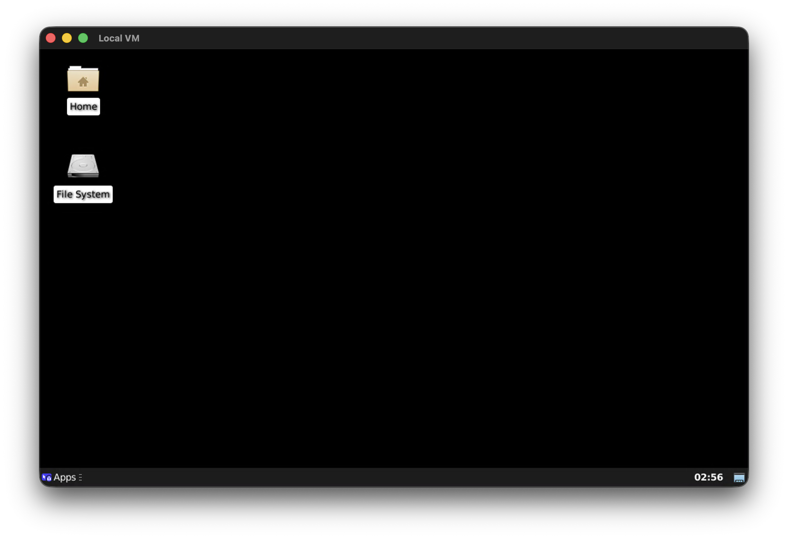

<p align="center"></p>
<h1 align="center">containerdesk-rdp</h1>
<p align="center">Test desktop container, over RDP</p>
<p align="center"></img>

RDP layer for [`containerdesk`](../containerdesk/). Runs xrdp with the xorgxrdp
Xorg backend, launching the XFCE desktop on login.

Published to GHCR as
[`ghcr.io/itisrazza/containerdesk-rdp`](https://github.com/itisrazza/ServerRemote/pkgs/container/containerdesk-rdp).

## Run the published image

```bash
docker run --rm -p 3389:3389 ghcr.io/itisrazza/containerdesk-rdp:latest
```

Connect to `rdp://localhost:3389`, log in with **user / user**, and pick the
*Xorg* session.

Unlike the VNC and SPICE images, this one runs the xrdp daemon as root — its
session manager needs it to authenticate and spawn the per-user session (which
itself runs as `user`, so it still gets the on-demand apps and menu entries from
`/home/user`).

## Build locally

```bash
./build-and-run.sh
```

Builds the base image, then this one, and runs it.

---

Development and testing artifact — **not production grade**. Test credentials
(user / user) and a self-signed cert; localhost only.
