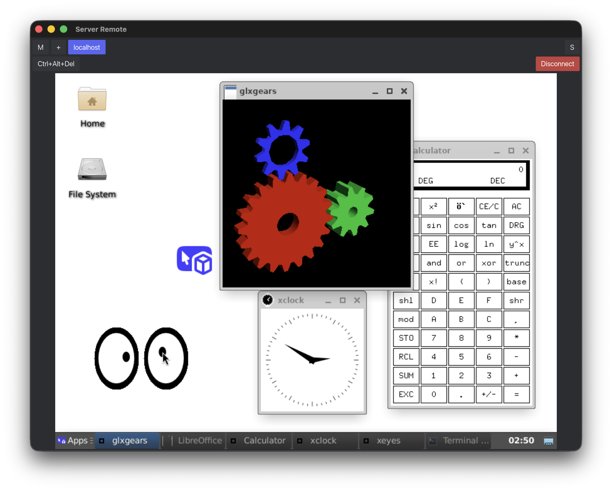

<p align="center"></p>
<h1 align="center">containerdesk-spice</h1>
<p align="center">Test desktop container, over SPICE</p>
<p align="center"></img>

SPICE layer for [`containerdesk`](../containerdesk/). Runs Xspice — a real Xorg
server with the SPICE server built in — and launches the XFCE desktop on it.

Because Xspice is Xorg-based it implements Xinerama, so (like the VNC image's
Xvfb) it doesn't crash LibreOffice.

> [!NOTE]
> Untested and **not published to GHCR** yet — pending verification on a Linux
> host. Build and run it locally for now.

## Build locally

```bash
./build-and-run.sh
```

Builds the base image, then this one, and runs it with the SPICE port published:

```
spice://localhost:5900
```

Connect with a SPICE client, e.g. `remote-viewer spice://localhost:5900`. No
ticket/auth (`--disable-ticketing`). The container stops when you log out of the
desktop or press Ctrl+C.

Override the resolution with `GEOMETRY` (WIDTHxHEIGHT):

```bash
docker run --rm -p 5900:5900 -e GEOMETRY=1280x800 \
  ghcr.io/itisrazza/containerdesk-spice:testing
```

---

Development and testing artifact — **not production grade**. No auth; localhost
only.
