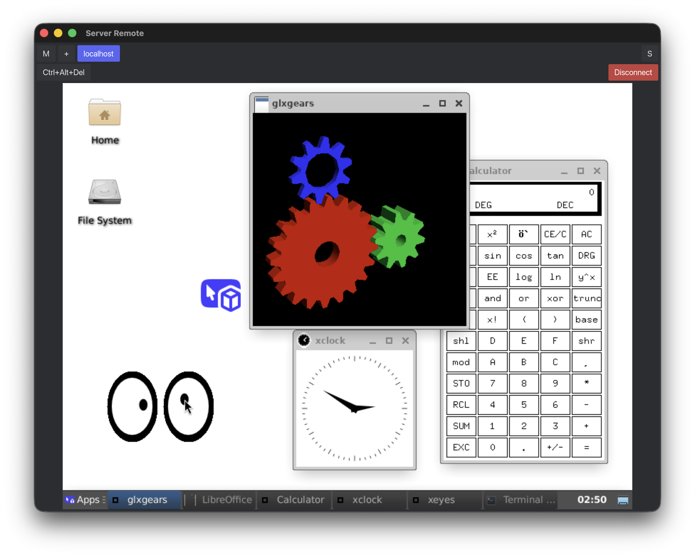

<p align="center"></p>
<h1 align="center">containerdesk-vnc</h1>
<p align="center">Test desktop container, over VNC</p>
<p align="center"></img>

VNC layer for [`containerdesk`](../containerdesk/). Runs the XFCE desktop on a
virtual framebuffer (Xvfb) and shares it over VNC with x11vnc.

Xvfb is a real X server, so — unlike Xvnc's built-in server — it implements
Xinerama and doesn't crash LibreOffice.

Published to GHCR as
[`ghcr.io/itisrazza/containerdesk-vnc`](https://github.com/itisrazza/ServerRemote/pkgs/container/containerdesk-vnc).

## Run the published image

```bash
docker run --rm -p 5900:5900 ghcr.io/itisrazza/containerdesk-vnc:latest
```

Then connect to `vnc://localhost:5900`. No password (`-nopw`), no encryption.
The container stops when you log out of the desktop or press Ctrl+C.

Override the resolution with `GEOMETRY` (WIDTHxHEIGHTxDEPTH):

```bash
docker run --rm -p 5900:5900 -e GEOMETRY=1920x1080x24 \
  ghcr.io/itisrazza/containerdesk-vnc:latest
```

## Build locally

```bash
./build-and-run.sh
```

Builds the base image, then this one, and runs it.

---

Development and testing artifact — **not production grade**. No auth, plaintext
protocol; localhost only.
