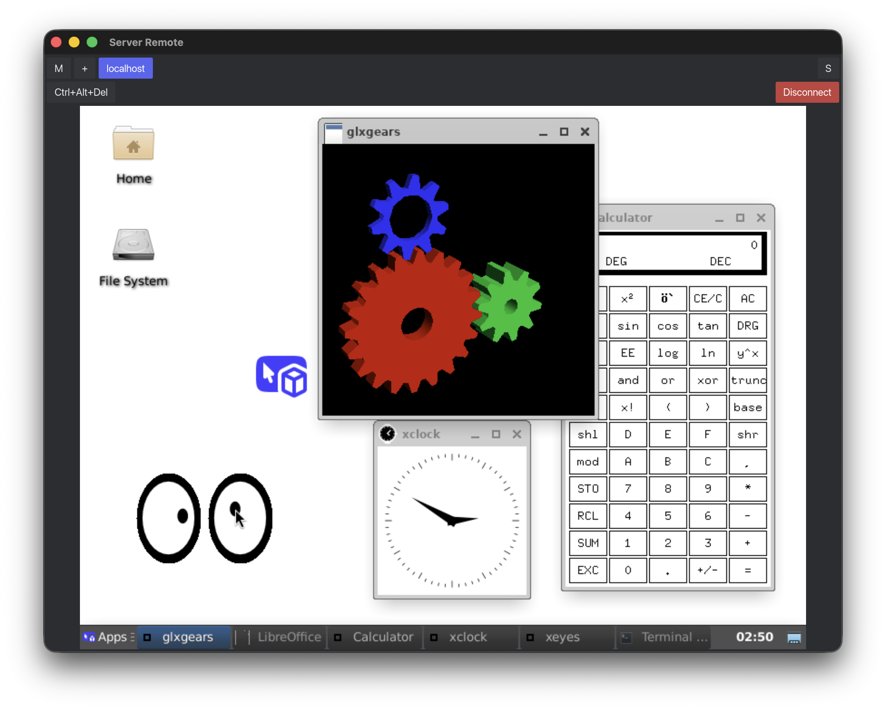

<p align="center"></p>
<h1 align="center">containerdesk</h1>
<p align="center">Test desktop container</p>
<p align="center"></img>

`containerdesk` is a protocol-agnostic XFCE desktop image. It ships the desktop
and core utilities only — it has no remote server of its own. The protocol
images layer one on top:

| Image | Protocol | Server |
| --- | --- | --- |
| [`containerdesk-vnc`](../containerdesk-vnc/) | VNC | Xvfb + x11vnc |
| [`containerdesk-rdp`](../containerdesk-rdp/) | RDP | xrdp + xorgxrdp |
| [`containerdesk-spice`](../containerdesk-spice/) | SPICE | Xspice |

> [!WARNING]
> These are **development and testing artifacts** for [ServerRemote] — throwaway
> desktops to point a remote-desktop client at. They are **not** production
> images: no hardening, default or blank credentials, plaintext protocols. Run
> them on localhost only.

[ServerRemote]: https://github.com/itisrazza/ServerRemote

## Published images

Built and pushed to GHCR by [CI](../../.github/workflows/containerdesk.yml)
whenever these folders change:

- [`ghcr.io/itisrazza/containerdesk`](https://github.com/itisrazza/ServerRemote/pkgs/container/containerdesk) — the base (not run directly)
- [`ghcr.io/itisrazza/containerdesk-vnc`](https://github.com/itisrazza/ServerRemote/pkgs/container/containerdesk-vnc)
- [`ghcr.io/itisrazza/containerdesk-rdp`](https://github.com/itisrazza/ServerRemote/pkgs/container/containerdesk-rdp)

`containerdesk-spice` isn't published yet — it's untested pending a Linux host.

## Build locally

```bash
./build.sh
```

This builds `ghcr.io/itisrazza/containerdesk:testing`. You don't run the base
directly — pick a protocol image and run its `build-and-run.sh`, which builds
this base first, then the protocol layer.

## On-demand apps

To keep the base small, heavyweight apps (Firefox, Chromium, LibreOffice) and
the display stress tools (glxgears, looping test video) aren't baked in. They
install on first launch through shims in [`user/.pkg-shims`](user/.pkg-shims/),
each with a menu entry that hands off to the real launcher once installed.
